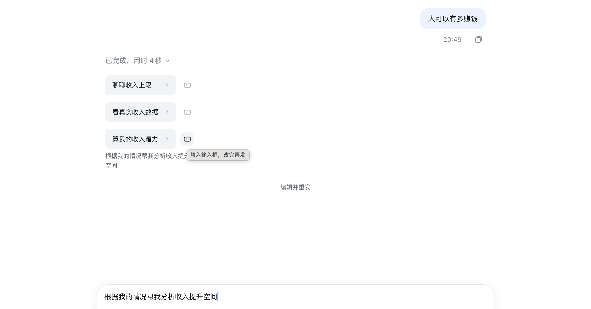
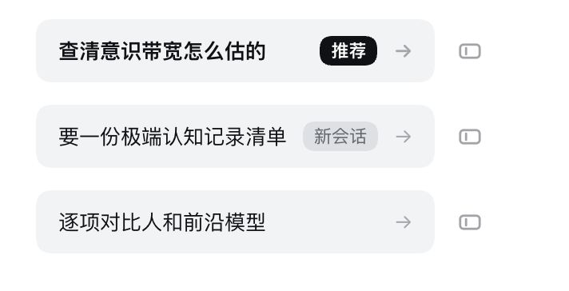

# dsh-suggestion-chips

[English](README.md) | [中文文档](README.zh.md)


Clickable **suggestion chips** under every reply in DeepSeek Harness. One click sends that text as your message — no typing. Each suggestion also has a small fill button on its right: it only puts that sentence into the composer, so you can edit it before sending. Destructive high-risk actions are marked with ⚠ warning and strictly intercepted from direct sending. Includes adoption indicator for past turns.

> [!NOTE]
> **Fork & Evolution**: This project is a deeply re-architected, production-hardened fork of [`hiJoeLee/dsh-suggest-actions`](https://github.com/hiJoeLee/dsh-suggest-actions). Built to address real-world security, usability, and resilience challenges, this project introduces a Level 0 deterministic fallback extractor (bilingual), a 6-dimensional MECE high-risk safety gate, zero-token context isolation via `presentationMeta`, reactive turn-isolated storage, adoption state tracking, and full internationalization.

It answers "I've read it, now should it do A or B": instead of composing the sentence yourself, just click it.

## Visual Demo & Workflow

<div align="center">
  
  <p><em>Figure 1: Real workflow — suggestion chips render under the reply; clicking the fill button safely places the full prompt into the composer for manual editing.</em></p>
</div>

<div align="center">
  
  <p><em>Figure 2: Badge hierarchy — "Recommended" pick pinned to top; "New Session" for clean context handoffs; equalized button width and dedicated fill triggers.</em></p>
</div>

## Core Advantages Over Upstream

| Dimension | Upstream (dsh-suggest-actions) | Enhanced (dsh-suggestion-chips) |
|---|---|---|
| **Deterministic Fallback** | Relies solely on tool calls; **zero suggestions** if the model just chats | **Level 0 Deterministic Extractor**: instantly parses confirmation sentences, option lists, and engineering conclusions from reply text (Chinese & English) |
| **Safety Gate** | Clicks execute immediately regardless of command destruction | **6-Dimensional MECE High-Risk Guard**: catches rm -rf, force push, db drops, and dangerous curl/scripts; marks with ⚠ and safely redirects to composer for review |
| **Token & Overhead** | Early versions echoed suggestions JSON back to context | **Zero Token Cost**: suggestions stay in `presentationMeta` for UI only; `concludeTurn()` finishes turns without extra round-trips |
| **Turn Isolation** | Flat global memory; page reload or fast turns drop buttons | **Reactive Store by `(sessionId, turn/seq)`**: replay from event stream upon reload, eliminating race conditions and leakage |
| **Adoption Tracking** | No visual feedback after user interaction | **Adoption Indicator**: marks matched actions as "Adopted" once user submits a prompt |
| **Badge System** | Basic display | "Recommended" (pinned top), "New Session" (handoff brief), and "Danger" (guarded) badges |
| **Internationalization** | Primarily Chinese-oriented strings | **Default English UI** + adaptive Chinese detection; complete bilingual documentation |


## Not the same thing as "composer completion"

There are already a few "next sentence" plugins (`dsh-suggest-prompt`, `dsh-prompt-for-me`, `dsh-suggest-ghost`, `dsh-input-assist`). They all live **inside the composer** as ghost text: they fire an **extra model call** to guess what you would say, offer one line, you accept with Tab, then **press Enter yourself**.

This one takes a different route:

|  | Composer completion | This plugin (dsh-suggestion-chips) |
|---|---|---|
| Where | inside the composer | **under the reply** (turn tail) |
| How many | one | **up to 5 by default**, all shown (extra ones fold away only if you raise the cap) |
| Who decides | the plugin guesses | **the model, from context**, or Level 0 deterministic fallback from text if tool call was omitted (Chinese and English) |
| Extra cost | **an extra model call** (a separate request to guess) | **zero extra token cost** — presentationMeta isolation, no re-injection into context |
| To accept | Tab, then Enter | **one click sends it** (dangerous actions safely fill composer first); fill button allows manual edits |
| If unwanted | ignore it or press Esc | just don't look at it; it never occupies the composer |

## Install

```bash
dsh plugin --profile desktop add dsh-suggestion-chips
```

Then **restart DSH and reload the page** — the host reads its plugin list only at startup, and the client bundle has to be re-fetched. Both steps matter.

## How it works

- **Host side**: registers a non-blocking `suggest_actions` tool. It returns immediately — the model calls it once to close a turn, passing 2-5 suggestions.
- **Client side** draws in two places:
  - a *silent collector* on `tool.call.toolview` — records the suggestions into plugin memory and renders nothing;
  - a *renderer* on `conversation.chat.turnTail` — reads that memory and draws the buttons.
- **Why the turn tail**: DSH folds "process" (thinking + tool calls) into a single collapsed line, so anything drawn inside a tool card is hidden by default. The turn tail sits outside that folding, so the buttons stay visible even when the process is collapsed.
- **Clicking** goes through `conversation.input.shell(sessionId).actions` (set draft → submit) — the exact same path as typing the sentence and pressing Enter.

## Stances and the recommended pick

Two things were added on top of a plain list of sentences.

**Stance.** Every suggestion carries one, and there are five: cautious (a smaller step — confirm before going further), standard (the normal next move along the current route), bold (same route, pushed faster and with more risk taken), alternative (the current approach is dropped), stop (this need not be done at all). A stance appears at most once per turn — repeats are dropped and the free slots go to other angles, so three suggestions that are really the same move never reach you. Five is the maximum (one per stance); when only two are worth offering, you get two.

The stance is **not drawn on the button**: it is a format constraint on the model. That is the point — telling a model "please offer different angles" is advice it can ignore, whereas a required field cannot be ignored.

**Pick.** The model marks the one it would do first, independently of its position in the list — the marked entry is moved to the top and carries a small badge. Its background is the same as the other buttons; only hovering darkens it, like every other button. A `stop` entry ("this need not be done") is pushed to the bottom wherever it was given; the rest keep the order you gave. When the options are genuinely interchangeable, nothing is marked.

**Hover a button** (or focus it with the keyboard) and it unfolds in place, showing the sentence that will actually be sent; move away and it folds back. The point is to keep "what you see" and "what gets sent" aligned — the label is a summary, and the sentence actually sent is usually longer. That sentence lives **outside the button** (a sibling element), so clicking it never sends anything — select and copy as you like.

**All buttons share one width**, sized by the longest label rather than each one's own content: the arrows line up in a column, and a long instruction no longer stretches its button.

**A fill button sits to the right of every suggestion (since 0.1.11; input-field icon).** Clicking it does **not** send: it clears the composer, drops the sentence in, and returns the caret — edit a few words, then press Enter. Use it when the suggestion is roughly right but the wording is not.

**All shown by default**: the per-turn cap is 5 (one per stance), and all of them render at once. The folding code is still there, but its threshold (5) equals the cap, so it normally never fires; raise the cap to 6 and the extra entry folds into a single "N more" line that unfolds in place when clicked — the unfolded ones are clickable too. The unfolded state is deliberately not remembered — scroll away and come back, and it is collapsed again.

The few words the plugin draws itself ("Recommended", "N more", "Show less") follow the interface language: Chinese in a Chinese UI, English otherwise.

Suggestions without a stance still render (backwards compatible).

## Leaner and more native (0.2.0)

- **Tool schema 3,822 → 1,465 chars** (≈956 → ≈366 tokens, sent on every request). Each rule is stated once, and the description now says *when not to call*: only when the task is done or blocked on a user-only choice, do doable steps first, never in plan mode.
- **The model sees one sentence.** The suggestion list travels through `output.presentationMeta` (persisted with the session log, read by the UI only) instead of being echoed back as JSON.
- **The turn ends at the call** via the host's `concludeTurn()` (configurable via `config.concludeTurn`, default `true`), saving one model round-trip per turn. Subagent sessions do not declare the tool.
- **Per-turn reactive store owned by `apply(ctx)`**: suggestions are indexed by `(sessionId, turn / seq)` with subscriber notifications and cleaned up via `ctx.effect`, preventing cross-turn duplication and mount-order races while keeping the package strictly focused on turn-tail action buttons.
- Old hosts fall back gracefully (one extra step, global declaration); 0.1.x sessions still render their buttons.

## Limits

- Requires the DSH **0.1.7** line (`conversation.chat.turnTail`, `conversation.input.shell`, `tool.call.toolview`).
- Button text comes from the model; keep labels under ~20 characters or they look heavy.
- Normal suggestions send immediately with no confirmation — by design. High-risk actions are intercepted and safely filled into the composer for review; to edit any suggestion first, use the fill button on the right.
- Rapid clicks are debounced for ~0.9s.

## License

MIT
